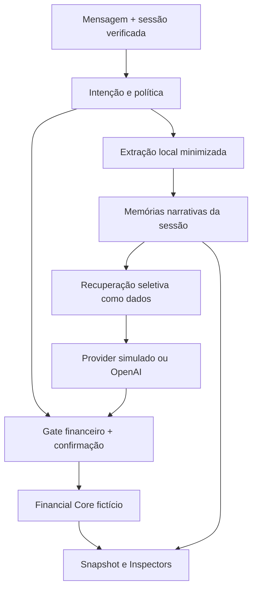

# Pulse Memory Engine V1

Motor de demonstração implementado em `shared/v2/memory-engine.ts`, independente de React. Contratos em `memory-contracts.ts`; orquestrador financeiro existente preservado. Base funcional: Personality V1 corrigida (`d1e45c6...`, PR #6). Nova branch `feat/pulse-personality-v2`.

## Arquitetura

O provider não grava memórias nem edita registros. A mensagem atual é a única autoridade para novas operações financeiras. Memórias recuperadas nunca ocupam papel de system instruction: são um bloco de dados JSON com role user, explicitamente marcado como não confiável para instruções. Preferências tipadas entram separadamente no prompt de sistema; histórico recente e resultados de ferramentas mantêm seus próprios papéis.

## Modelo e tipos

Registro narrativo contém: UUID, ownerId da sessão, topic, type, content limitado, status, source, confidence e createdAt/updatedAt ISO. O proprietário é gerado pelo servidor, não escolhido pelo modelo ou por argumento do cliente.

| Informação | Persistência |
| --- | --- |
| Preferências explícitas | Campos tipados existentes de estilo, extensão, proatividade, explicações, exemplos e emojis; não duplicados em narrativas. |
| Objetivos de vida | Temas morar sozinho, casamento, mudar de cidade. |
| Intenções exploratórias | Deixar emprego, abrir negócio, vender pipoca. |
| Projeto | Estudar programação. |
| Inferência conversacional | Janela minimizada de sinais informal/neutro e marca de estilo explicitamente escolhido; provisória, sem conteúdo pessoal bruto. |

Estados: `exploring`, `planned`, `declared_decision`, `abandoned`, `outdated`. “Vou vender pipoca” significa plano; nunca “empresa em funcionamento”. “Decidi que vou sair...” significa decisão declarada, não demissão já ocorrida. “Desisti...” atualiza para abandono.

Os sete temas são curados e auditáveis. Conteúdo automático é uma frase canônica curta, sem valores monetários, nomes íntimos, dados de terceiros ou mensagem integral. Não há inferência psicológica, embedding ou banco vetorial. O estado narrativo tem teto estrutural de 30 registros, mas a deduplicação por um dos sete temas atualmente limita o conjunto a sete registros.

## Extração e atualização

Extração determinística de declarações próprias inequívocas: pensando/quero/vou/planejo/pretendo/decidi/estou estudando. Perguntas, execuções financeiras e pedidos de recordação não criam narrativas. Temas íntimos/sensíveis conhecidos, credenciais, números longos e instruções de manipulação são rejeitados na extração.

A memória automática exige enabled e noticeAccepted. Por padrão ambos são false. Uma ordem manual “Lembre que...” pode salvar um tema suportado, sem ativar a coleta automática. Dados não suportados não são inventados.

Registro do mesmo tema é atualizado, não duplicado. Repetição sem mudança não renova timestamp. Mudanças explícitas de status de uma memória já existente são correções do usuário; podem ser aplicadas com coleta automática desativada, sem criar registros novos.

Correções manuais podem alterar texto (até 240 caracteres) e status no Inspector. Recebem source `user_correction`, confidence high e novo timestamp. A validação bloqueia conteúdo sensível conhecido, mas não constitui detector universal de PII: não inserir segredos, dados íntimos ou financeiros reais na demonstração.

## Recuperação e custo

- Até três memórias por interação.
- Payload narrativo JSON de até 800 caracteres, mais o prefixo fixo que o identifica como dados.
- Priorização por tema relevante, confiabilidade e atualização recente.
- Somente estados ativos para contexto do modelo; abandoned/outdated não entram como planos ativos.
- Pedidos de opinião podem recuperar objetivos de vida relacionados, por exemplo casamento ao avaliar uma compra.
- Execução financeira, correção, confirmação e preferências não recebem narrativas.
- Consulta direta “o que você lembra sobre mim?” lista registros efetivamente armazenados; recordação de tema inexistente não pode ser inventada pelo modelo, pois é respondida pelo código.
- Extração usa **zero chamadas adicionais à OpenAI**. O provider recebe apenas memórias selecionadas na chamada principal.
- Métricas técnicas da interação: quantidade armazenada/recuperada, tamanho do payload e extractionCalls=0. Não incluem conteúdo pessoal em logs.

Controles de memória/limpeza, sem chamada de modelo, têm bucket próprio de 30 requisições por minuto/instância; conversação mantém seis/minuto/instância. Não são quotas globais. Mantidos limites anteriores: histórico de dez mensagens, quatro etapas de modelo, oito ferramentas, timeout 35 segundos e teto medido de 14 mil tokens por interação. Crescimento do estado narrativo, do estilo inferido e do contexto é limitado. Não se promete quantidade exata de tokens por caractere; usage real continua sendo medido pelo provider.

## Persistência, isolamento e duração

| Modo | Armazenamento | Limites reais |
| --- | --- | --- |
| Simulação | Estado por aba em sessionStorage; schema tipado e ownerId da sessão. | Pode ser inspecionado/alterado pelo dono do navegador; não é fronteira de segurança para produção. |
| Real | Snapshot de sessão criptografado/autenticado AES-GCM no token existente; frontend guarda token opaco e cache visual minimizado. | Sem banco central, expira até seis horas após criar sessão; sem sincronização entre dispositivos ou memória de conta permanente. |

Memórias e preferências ficam separadas de `history` e dos dados financeiros. Limpar conversa preserva ambas, limpa referências recentes e invalida confirmação financeira pendente. Atualizar a página recupera o estado dentro do escopo válido; “Nova sessão” reinicia tudo. Cache visual de memória real respeita a validade informada pelo servidor e não é aceito como autoridade. No simulador, registros mais antigos que 30 dias são removidos ao carregar/usar o engine; no real, a validade menor do token prevalece.

O backend aceita mensagem/ação estritamente tipadas e token assinado; não aceita ownerId, userId, workspace, estado narrativo ou financeiro arbitrário do cliente. Todo registro deve pertencer à sessão, condição também validada no schema da sessão. Ações só alcançam IDs existentes naquele snapshot. Testes cobrem tentativa de acesso cruzado e campos forjados.

Vercel Authentication protege o deployment, mas isso NÃO é uma implementação de identidade persistente por conta Vercel. Isolamento de demonstração é por posse do token de sessão. Uma pessoa com uma cópia válida desse token tem acesso ao mesmo snapshot. Compartilhar tokens não é seguro.

## Controles, exclusão e revogação

Memory Inspector permite habilitar/desabilitar automático, consultar, corrigir, excluir e limpar. Exibe tipo, status, origem, confiança, criação/atualização, dados armazenados e quais foram recuperados na interação. Não mostra prompt privado, credenciais ou raciocínio do modelo. Histórico, preferências, narrativas e finanças têm áreas distintas.

Comandos:

- “Pulse, o que você lembra sobre mim?”
- “Esquece aquela ideia de vender pipoca.”
- “Na verdade, não quero mais sair do emprego.”
- “Não quero que você guarde informações pessoais automaticamente.”
- “Habilitar memória automática.”
- “Limpar memórias.”
- “Lembre que vou vender pipoca.”

Ao excluir/limpar: remove registros, grava tombstones por tema e limpa histórico/cache de requests recentes. Ao corrigir: substitui o registro e limpa contexto anterior. Esses caminhos invalidam pendências financeiras que dependiam do contexto, preservando transações/preferências. A interface só confirma após retornar o estado atualizado do servidor (ou após sucesso local no modo simulado).

Um tema esquecido não reaparece por recuperação, histórico antigo ou extração automática na cadeia atual. Para voltar a guardá-lo, pedir explicitamente “Lembre que...”. Limpar todas as memórias cria tombstones dos temas suportados. Desativar coleta não apaga o que já foi salvo; excluir/limpar são controles separados.

**Limite de revogação:** snapshots antigos podem ser copiados e reenviados enquanto válidos. Exclusão/limpeza não revoga globalmente tokens antigos nem impede um proprietário de restaurar um snapshot anterior. Não há ledger central, coordenação entre instâncias ou garantia de exclusão em cópias externas. A cadeia corrente e o cache visual são limpos; não se afirma exclusão global. Para produção, implementar armazenamento autoritativo por identidade autenticada, versões/ledger, revogação, retenção e eliminação dos backups/caches apropriadas.

O histórico recente existente ainda contém mensagens originais limitadas e criptografadas no modo real: minimizar narrativas não significa que o chat inteiro deixa de existir. Histórico é temporário e separado; exclusões/correções narrativas limpam esse contexto para evitar reintrodução de dados antigos.

## WhatsApp: interfaces, não integração

`shared/v2/channel.ts` fornece `AgentContext`, `demoContext` e `processMessage`, com identidade, workspace, sessionId, canal e origem da verificação. Provider, personalidade, engine, preferências e execução são módulos independentes de React.

Frontend simulado e handler real já passam pela interface de canal. O contexto de demonstração só é construído pelo chamador com uma sessão previamente verificada. `processMessage` recusa identidade/workspace divergentes. O campo authentication é metadado do chamador confiável, não autenticação por si mesmo. Não há endpoint WhatsApp, webhook, envio, vinculação de telefone ou autorização baseada apenas em número. Uma etapa futura deverá resolver autenticação/vinculação real e armazenamento seguro antes de conectar o canal.

## Evidências e limites funcionais

Os cenários obrigatórios estão cobertos em `tests/memory.test.ts`: saudação, carreira, informalidade sem hostilidade, ideia/plano, colaboração, continuidade sem histórico, abandono, opinião com objetivo, execução discreta, seriedade, esquecimento e moradia sem transações. Também cobre risco, deduplicação, retenção, isolamento, tokens assinados, correção, coleta desativada, preferências, orçamento, channel context e provider real mockado.

Testes anteriores de Personality V1 e financeiro foram executados. A mudança intencional de “quero guardar” para narrativa usa a mesma criação financeira sob ordem clara “defina/crie uma meta”; confirmação de alteração continua intacta.

Simulação usa templates e temas fechados, não compreensão geral. A extração conservadora pode deixar intenções não suportadas sem memória. Mudança de cidade não guarda nomes de cidades; casamento não guarda datas, valores ou detalhes íntimos. O modo real conversa livremente pelo modelo, mas extração/persistência continuam neste escopo conservador. Não há lembranças de conta permanentes, inferência sensível, embeddings, banco novo ou cadastro de produção.

Resultado local final: 200 testes unitários/backend e 14 testes Playwright desktop/mobile aprovados. Os fluxos financeiros e Personality V1 foram preservados; os testes de memória real usam mocks. TypeScript, build:api e Vite aprovados. Smoke Node do bundle importou a função e retornou GET 405; inspeção do asset cliente confirmou ausência do prompt de sistema. `git diff --check` aprovado. Testes OpenAI são mocks, sem consumo real nesta rodada. PR e Preview verificados abaixo. OpenAI ao vivo desta V2 só será declarada com evidência; mocks e modo simulado não equivalem a essa homologação.

## Arquivos desta evolução

| Área | Arquivos |
| --- | --- |
| Engine e canais | `shared/v2/memory-contracts.ts`, `shared/v2/memory-engine.ts`, `shared/v2/conversation.ts`, `shared/v2/channel.ts` |
| Integração/política | `shared/v2/agent.ts`, `shared/v2/contracts.ts`, `shared/v2/personality.ts`, `shared/v2/policy.ts`, `shared/v2/simulation.ts` |
| Servidor e bundle | `server/v2/handler.ts`, `server/v2/openai.ts`, `server/v2/personality-prompt.ts`, `api/conversation.js` |
| Interface | `src/MemoryInspector.tsx`, `src/main.tsx`, `src/style.css` |
| Testes | `tests/memory.test.ts`, `tests/e2e/lab.spec.ts`, `tests/personality.test.ts`, `tests/v2.test.ts` |
| Documentação | `PULSE_PERSONALITY_BIBLE_V2.md`, `PULSE_MEMORY_ENGINE_V1.md`, `README.md` |

23 arquivos criados/alterados; `shared/v2/finance.ts` permaneceu intacto. As duas primeiras regressões da integração foram detectadas pelos testes (validação de pendência e espera assíncrona de checkbox real), corrigidas antes da rodada final. Publicação apenas após os checks aprovados.

## Entrega verificada

- Branch: `feat/pulse-personality-v2`; PR https://github.com/Nastatherossi/Agente-pulse-ia/pull/7 (base V1 corrigida, sem merge na main).
- Preview final: https://pulse-ai-af24q9ozl-matheusnastaro5-6769s-projects.vercel.app/
- Deployment `dpl_FuDk35jAK8gRaChN5TNAGq28815Q`, estado READY, target Preview, fonte GitHub no projeto existente pulse-ai-lab.
- Código validado: `9e7ce0358e1bf3150af735aa2232143120a39ca7`. Árvore local/remota idêntica `3ee3ef14dc9b44a57e6ff8c59e7d68ab596b2f93` antes deste complemento documental.
- Proteção consultada após publicar: SSO enabled=true, deploymentType=all. GET anônimo da página e `/api/conversation`: HTTP 302, Protected by Vercel Authentication, redirecionamento ao login. Sem bypass ou mudança de autenticação.
- 200/200 testes backend e 14/14 Playwright desktop/mobile passaram; TypeScript e build local/remoto aprovados. Smoke do bundle final: importação Node e GET405.
- OpenAI Personality V2 **não homologada ao vivo nesta rodada**. Providers/handler/ações de memória e cadeia de token foram validados com mocks. Sem chamada paga ou recuperação da chave real. Falta acesso autenticado ao Preview para fazer testes pontuais com o modelo real.
- Próximo passo de homologação: habilitar memória na sessão do Preview autenticado, declarar intenção de carreira/negócio, limpar conversa, retomar assunto, alterar/abandonar/excluir memória e confirmar que um registro simples permanece discreto. Depois, preparar identidade e armazenamento autoritativos antes de conectar WhatsApp em outra missão.
- No modo real, é necessário iniciar nova sessão quando o token de até seis horas expirar. Nenhuma persistência permanente por conta é prometida.
- Main, pulse-finance e Supabase não receberam alterações; Financial Core segue fictício e operações existentes continuam exigindo confirmação.
